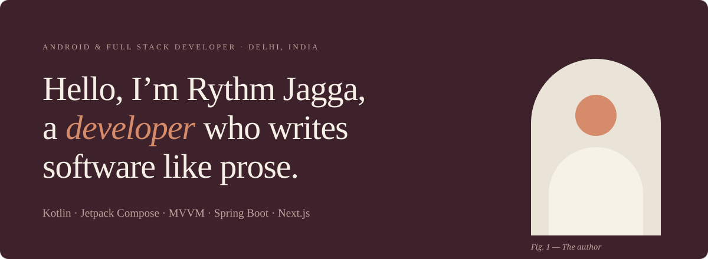

  <a href="https://rythm-claude.vercel.app">Portfolio</a> &nbsp;·&nbsp;
  <a href="mailto:rythm.meta@gmail.com">Email</a> &nbsp;·&nbsp;
  <a href="https://linkedin.com/in/rythm-jagga-393791309">LinkedIn</a> &nbsp;·&nbsp;
  <a href="https://github.com/Rythmokay">GitHub</a>

 

## About

I build Android apps in Kotlin and Jetpack Compose, structured with MVVM, and integrate the REST APIs they share with web teams. At Concept Kart I built **MyAudiocular** from scratch as the second engineer on a start-up's founding tech team: DAC integration, a 10-band parametric equalizer and AI-powered EQ recommendations.

Before that I built cinema ticket booking with interactive seat selection at Picturetime, and LLM microservices with LangChain and LangGraph. Today I also mentor new engineers on architecture, code quality and delivery.

 

## Experience

**Android Developer, Full Stack** · *Concept Kart Private Limited*
 May 2026 – Present · Delhi, India

- Built the MyAudiocular Android app from scratch alongside a Next.js web platform
- Implemented DAC integration, a 10-band parametric equalizer and core audio processing
- Built AI-powered EQ recommendations; integrated the REST APIs for audio configuration and presets
- Mentor incoming engineers on architecture, code quality, documentation and delivery

**Android & Web Developer Intern** · *Picturetime Digiplex Pvt. Ltd.*
 Feb 2026 – May 2026 · Delhi, India

- Built the cinema ticket booking flow with interactive seat selection for the Android app and [picturetime.in](https://picturetime.in)
- Validated backend APIs with Postman so the Android and web clients shared the same endpoints
- Developed a Next.js admin portal for managing events, with filtering and Excel export

**Generative AI Intern** · *Knowledge Excel Private Limited*
 Aug 2025 – Oct 2025 · Delhi, India

- Built Python microservices for LLM conversational workflows with LangChain and LangGraph
- Built RAG pipelines on Chroma, validating structured inputs and outputs with Pydantic

 

## Selected work

**MyAudiocular**
 Audiophile Android app built from scratch: DAC integration, a 10-band parametric equalizer and AI-powered EQ recommendations, with REST-backed presets shared with the Next.js web platform.
 Kotlin · Jetpack Compose · MVVM · REST APIs

**AI-Powered Influencer Management Portal**
 Gemini-driven automation that finds influencer YouTube reviews (49 tracked), plus a CRM for products, shipments and returns with JWT auth, Excel import/export and Docker.
 React · Spring Boot · PostgreSQL · Gemini API

**Flight Booking Platform**
 Full-stack airline booking app with flight search across 17 airports, Razorpay payments, JWT auth and a staff console.
 React · Spring Boot · PostgreSQL · Razorpay

 

## Stack

| | |
| :-- | :-- |
| **Android** | Kotlin · Jetpack Compose · MVVM · Gradle · DAC & audio processing · Parametric EQ |
| **Languages & APIs** | Kotlin · Java · Python · TypeScript · SQL · REST · Postman · Git |
| **Backend & data** | Spring Boot · PostgreSQL · MongoDB · Flyway · Docker · Maven |
| **AI & web** | Gemini API · Prompt engineering · LangChain · LangGraph · RAG · Chroma · Next.js · React · Tailwind CSS |

 

## Education & recognition

**B.Tech, Artificial Intelligence & Data Science** · Guru Gobind Singh Indraprastha University
 2022 – 2026 · CGPA 7.4

**Third place, Hackunicorn** · AI-powered catering web app
 2023

**Freelance** · Delivered 3+ client platforms, including the Moksh Foundation NGO website
 2024 – Present

 

