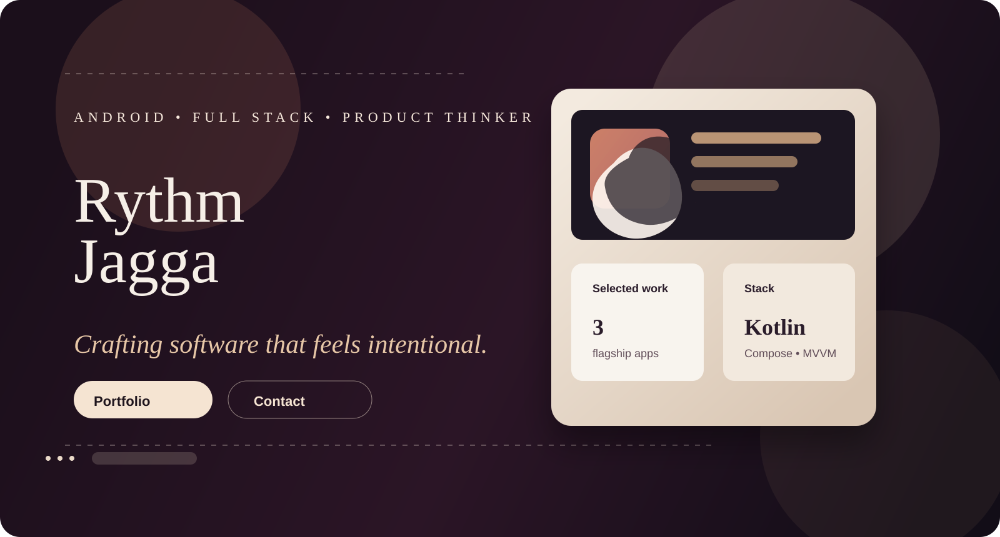
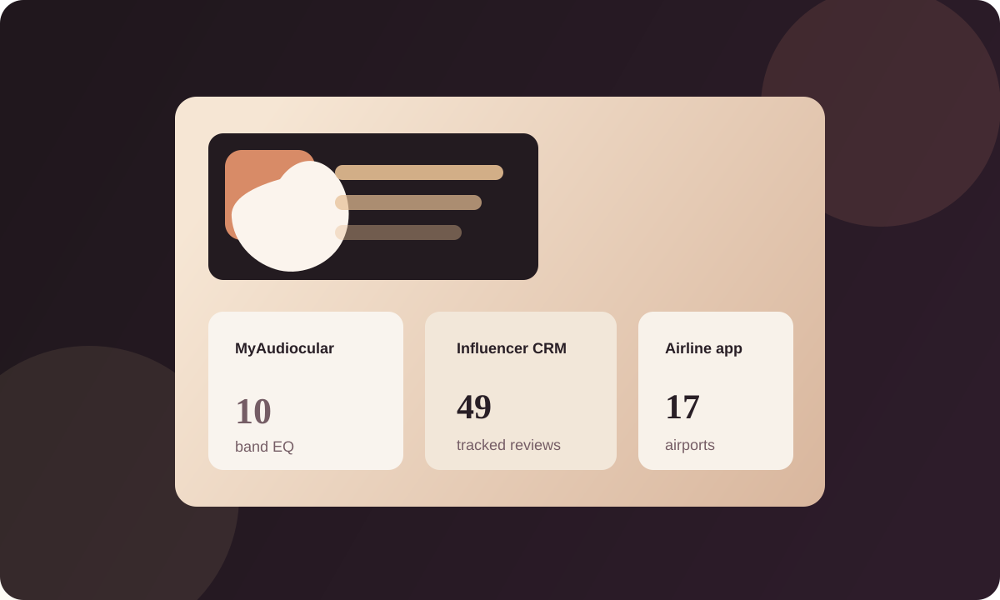

  

  <a href="https://rythm-claude.vercel.app">Portfolio</a> &nbsp;·&nbsp;
  <a href="mailto:rythm.meta@gmail.com">Email</a> &nbsp;·&nbsp;
  <a href="https://linkedin.com/in/rythm-jagga-393791309">LinkedIn</a> &nbsp;·&nbsp;
  <a href="https://github.com/Rythmokay">GitHub</a>

  

## About

I design and build products that feel as strong as they perform — from Android experiences in Kotlin and Jetpack Compose to full-stack systems that support real users at scale. I work across product thinking, mobile architecture, and AI-driven workflows, building polished experiences with clear intent and measurable outcomes.

At Concept Kart, I built MyAudiocular from the ground up as the second engineer on the founding product team, shipping DAC integration, a 10-band parametric equalizer, and AI-powered EQ recommendations. Before that, I worked on seat-selection booking flows, event admin tooling, and LLM-powered backend services.

## Snapshot

  <table>
    <tr>
      <td width="25%"></td>
      <td width="25%"></td>
      <td width="25%"></td>
      <td width="25%"></td>
    </tr>
  </table>

## Selected work

### MyAudiocular

Audiophile Android app built from scratch with DAC integration, a 10-band parametric equalizer, and AI-powered EQ recommendations. The experience is powered by MVVM architecture and REST APIs shared across the app and Next.js web platform.

- Kotlin · Jetpack Compose · MVVM · REST APIs
- Product strategy, audio UX, system design, and collaboration with web teams

### AI-Powered Influencer Management Portal

A smart operations platform that tracks influencer YouTube reviews, supports product and shipment workflows, and enables CRM administration with JWT auth, Excel workflows, and Dockerized delivery.

- React · Spring Boot · PostgreSQL · Gemini API
- Automation, data systems, and production-ready tooling

### Flight Booking Platform

A full-stack airline platform with 17-airport coverage, payment flows, authentication, and a staff console for flight operations and management.

- React · Spring Boot · PostgreSQL · Razorpay
- Multi-step product UX, backend orchestration, and resilient API design

## Core stack

- Android: Kotlin, Jetpack Compose, MVVM, Gradle, DAC & audio processing, parametric EQ
- Languages & APIs: Kotlin, Java, Python, TypeScript, SQL, REST, Postman, Git
- Backend & data: Spring Boot, PostgreSQL, MongoDB, Flyway, Docker, Maven
- AI & web: Gemini API, Prompt engineering, LangChain, LangGraph, RAG, Chroma, Next.js, React, Tailwind CSS

## Experience

### Android Developer, Full Stack · Concept Kart Private Limited
May 2026 – Present · Delhi, India

- Built the MyAudiocular Android app from scratch alongside a Next.js web platform.
- Implemented DAC integration, a 10-band parametric equalizer, and core audio processing features.
- Added AI-powered EQ recommendation logic to improve personalization and user outcomes.
- Integrated REST APIs for audio configuration, preset management, and product workflows.
- Mentor incoming engineers on architecture, code quality, documentation, and delivery.

### Android & Web Developer Intern · Picturetime Digiplex Pvt. Ltd.
Feb 2026 – May 2026 · Delhi, India

- Built the cinema ticket booking flow with interactive seat selection for Android and web.
- Validated backend APIs with Postman to keep mobile and web clients aligned.
- Developed a Next.js admin portal for event management, filtering, and Excel export.

### Generative AI Intern · Knowledge Excel Private Limited
Aug 2025 – Oct 2025 · Delhi, India

- Built Python microservices for LLM workflows using LangChain and LangGraph.
- Developed RAG pipelines with Chroma and used Pydantic for structured validation.

## Education & recognition

- B.Tech, Artificial Intelligence & Data Science · Guru Gobind Singh Indraprastha University · 2022 – 2026 · CGPA 7.4
- 3rd place, Hackunicorn · AI-powered catering web app · 2023
- Freelance · Delivered 3+ client platforms, including the Moksh Foundation NGO website · 2024 – Present

  

